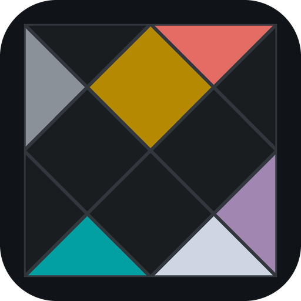

  

<h2 align="center">Navagraha für Nextcloud</h2>

Neun Planeten, neun Farben — ein Farbschema, abgelesen aus einem Geburtshoroskop.

  <a href="https://daehnie.github.io/navagraha/">Zur Seite</a> · <a href="#english">English</a>

Zwei Dateien, je ein Paar aus einer hellen und einer dunklen Variante
desselben Grundes:

| Datei                    | Grund   | Helles Design | Dunkles Design |
|--------------------------|---------|---------------|----------------|
| `navagraha-prithvi.css`  | Prithvi | Ushas         | Pratipada      |
| `navagraha-vayu.css`     | Vayu    | Tula          | Swati          |

Nicht vier Dateien mit je einer Variante: Ob hell oder dunkel, entscheidet
in Nextcloud jeder Benutzer für sich unter **Aussehen und Barrierefreiheit**,
und das ist eine Einstellung der Barrierefreiheit. Eine Datei belegt deshalb
beide Stellungen des Schalters — und die Stellung *System-Design* dazu, die
der Systemdarstellung folgt.

## Einbauen

Das Farbschema kommt als CSS. Nextcloud nimmt eigenes CSS über die App
**Custom CSS** an; Dateien auf dem Server müssen dafür nicht angefasst
werden. Beide Schritte brauchen ein Administrationskonto und gelten für die
ganze Instanz.

1. **Profilbild → Apps** öffnen, dort nach **Custom CSS**
   (`theming_customcss`) suchen und die App aktivieren.
2. **Profilbild → Administrationseinstellungen → Design** öffnen. Unten steht
   **Benutzerdefiniertes CSS**: den ganzen Inhalt einer der beiden Dateien
   dort einfügen und **Speichern** drücken. Die Seite einmal neu laden.
3. Unter **Profilbild → Aussehen und Barrierefreiheit** das gewünschte Design
   wählen — *Helles Design*, *Dunkles Design* oder *System-Design*.

Zum Wechseln in Schritt 2 den Inhalt durch den der anderen Datei ersetzen,
zum Entfernen das Feld leeren.

## Gut zu wissen

**Der Hintergrund ist ein Bild, solange man ihn nicht auf Farbe stellt.**
Nextcloud legt hinter Kopfzeile und Anmeldung standardmäßig ein Foto. Unter
**Aussehen und Barrierefreiheit → Hintergrund und Farbe** steht
**Einfarbiger Hintergrund**; erst damit kommt der Grund der Variante zum
Vorschein.

**Die Farbwähler des Designs greifen nicht mehr.** Die Primärfarbe aus den
Verwaltungseinstellungen und die eigene Hintergrundfarbe jedes Benutzers
werden von den Variablen dieser Datei überschrieben. Den Akzent trägt
Shukra, wie Schreibmarke und Knopf in den anderen Portierungen.

**Die Hochkontrast-Designs bleiben, wie Nextcloud sie ausliefert.** Sie
lösen auf 7:1, Navagraha auf 4,5:1 — eingefärbt wären sie nicht mehr, was
ihr Name verspricht. Wer eines von beiden wählt, sieht kein Navagraha.

**Meldungen tragen ihre Farbe in Zeichen und Schrift, nicht in der Fläche.**
Fehler, Warnung, Erfolg und Hinweis stehen auf denselben Flächen wie alles
andere; Mangala, Surya, Budha und Shani färben das Symbol und den Text.
Ein eingefärbter Grund wäre eine Farbe, gegen die nichts gemessen wurde.

**Ohne Anmeldung gilt die Systemdarstellung.** Anmeldeseite und öffentliche
Freigaben kennen kein gewähltes Design und folgen deshalb `prefers-color-scheme`.

## Galerie

**Navagraha Swati** · dunkel

**Navagraha Pratipada** · dunkel

**Navagraha Ushas** · hell

**Navagraha Tula** · hell

---

## English

Nine planets, nine colours — a colour scheme read from a birth chart.
[Visit the site](https://daehnie.github.io/navagraha/en/).

Two files, each a pair of one light and one dark variant sharing a ground:

| File                     | Ground  | Light theme | Dark theme |
|--------------------------|---------|-------------|------------|
| `navagraha-prithvi.css`  | Prithvi | Ushas       | Pratipada  |
| `navagraha-vayu.css`     | Vayu    | Tula        | Swati      |

Not four files with one variant each: in Nextcloud, light or dark is every
user's own choice under **Appearance and accessibility**, and that choice is
an accessibility setting. One file therefore fills both positions of the
switch — and *System default* along with them, which follows the system
appearance.

1. Open **Profile picture → Apps**, look for **Custom CSS**
   (`theming_customcss`) and enable it.
2. Open **Profile picture → Administration settings → Theming**. At the
   bottom is **Custom CSS**: paste the entire contents of one of the two
   files there and press **Save**. Reload the page once.
3. Under **Profile picture → Appearance and accessibility**, pick the theme
   you want — *Light theme*, *Dark theme* or *System default theme*.

To switch, replace the contents in step 2 with the other file; to remove it,
empty the field. Both steps need an administrator account and apply to the
whole instance.

Nextcloud puts a photo behind the header and the login page by default.
**Appearance and accessibility → Background and colour → Plain background**
turns it off, and only then does the ground of the variant show.

The colour pickers in Theming no longer take effect: the primary colour and
each user's background colour are overridden by the variables in this file.
Shukra carries the accent, as it does for cursor and button in the other
ports.

The high contrast themes stay the way Nextcloud ships them. They are solved
to 7:1 where Navagraha is solved to 4.5:1 — tinted, they would no longer be
what their name promises.

Status messages carry their colour in the icon and the text, not in the
surface. Error, warning, success and info sit on the same surfaces as
everything else; Mangala, Surya, Budha and Shani colour the symbol and the
words. A tinted ground would be a colour nothing was measured against.

Logged out, the system appearance applies: the login page and public shares
know no chosen theme and follow `prefers-color-scheme`.
